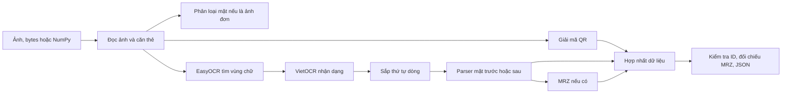

# Hệ thống hoạt động ra sao

## Các bước chính

1. `CCCDPipeline.load_image` đọc đường dẫn, bytes hoặc NumPy. `CardAligner` tìm bốn góc và nắn phối cảnh về 1000×630. Khi không tìm được góc tin cậy, nó resize toàn ảnh; có thể kéo méo chữ.
2. Với `process(image)` không ép mặt, OCR sơ bộ lấy chữ để `SideClassifier` đánh giá. Không phân loại được thì chọn mặt trước. Với `process_both_sides`, thứ tự ảnh do người gọi quyết định.
3. `QRDecoder` thử vùng góc trên bên phải của ảnh đã căn, rồi thử ảnh gốc nếu chưa thấy QR. QReader phát hiện và giải mã; parser chỉ nhận payload có dấu `|` và ID 12 chữ số.
4. `OCREngine` che vùng QR trên bản sao để không trộn chữ QR vào OCR, EasyOCR/DBNet phát hiện hộp chữ, VietOCR nhận dạng tiếng Việt, `ReadingOrderSorter` ghép lại theo dòng. Mặt sau CCCD có thể thử OCR riêng vùng MRZ.
5. `FrontRuleExtractor` và `BackRuleExtractor` dùng quy tắc chuỗi/regex để tìm các trường. MRZ bổ sung ID, ngày sinh, giới tính, hạn dùng nếu đủ điều kiện; checksum được lưu riêng.
6. `DataFusion` chọn nguồn cho từng trường, chuẩn hóa Unicode, kiểm tra cấu trúc số căn cước, đối chiếu MRZ và tạo `FinalCCCDResult`.

### MRZ được đọc như thế nào

Vùng MRZ ở phần dưới mặt sau được DBNet18 tìm theo dòng. EasyOCR nhận dạng các dòng này bằng model `latin_g2` (được chọn tự động khi khởi tạo Reader với `['vi', 'en']`). Đây là **model**: nó xem ảnh và dự đoán xác suất cho các ký tự. `greedy` là **cách giải mã** đầu ra của model: ở mỗi bước, chọn ký tự có xác suất cao nhất rồi xử lý ký tự lặp và ký tự trống theo CTC để tạo chuỗi. Hai thứ được dùng cùng nhau, không phải hai model thay thế nhau. MRZ chỉ cho phép các ký tự `0–9`, `A–Z`, `<`; VietOCR dùng cho chữ thông thường trên thẻ. Sau OCR, parser đọc các vị trí cố định và kiểm tra checksum MRZ.

## Quy tắc hợp nhất hiện tại

| Trường | Thứ tự nguồn chính |
|---|---|
| `id`, `name`, `dob`, `gender` | QR → chữ mặt trước → MRZ cho phần còn thiếu (`gender` còn có thể suy ra từ ID) |
| `residence` | QR → chữ mặt trước → chữ mặt sau |
| `origin` | Chữ mặt trước → chữ mặt sau |
| `issue_date` | Chữ mặt sau → QR |
| `issue_loc` | Chữ mặt sau |
| `expiry_date` | Chữ mặt trước → chữ mặt sau → MRZ |
| `father_name`, `mother_name`, `cmnd_old` | QR |

Quy tắc là ưu tiên nguồn, chưa phải xác suất đúng. Khi QR và MRZ khác nhau, `validation.mrz_checks` ghi `false` và `warnings` ghi chênh lệch; dữ liệu nguồn ưu tiên vẫn được giữ. `mrz_checksums` ghi tính hợp lệ checksum MRZ, `null` nếu thiếu ký tự để kiểm tra. `validation.is_valid_12_digits` chỉ kiểm tra cấu trúc, không phải xác minh với cơ quan cấp.

## Cấu hình và file khóa

`vgg_seq2seq.yml` là cấu hình VietOCR, gồm kiến trúc và URL trọng số. Chương trình dùng file `.easyocr_models/model/vgg_seq2seq.pth` (editable) hoặc `~/.cache/vn_id/.easyocr_models/model/vgg_seq2seq.pth` (wheel) nếu đã có, ghi đè `weights` và tắt tải backbone dự huấn luyện. Không có file tại chỗ thì Predictor dùng URL trong YAML. `device` YAML bị ghi đè ở runtime.

`pyproject.toml` định nghĩa các dependency của pipeline, gồm OCR và QR. `uv.lock` ghi phiên bản cụ thể và hash để `uv sync --locked` cài lặp lại. Cần cập nhật lock khi sửa dependency bằng `uv lock`, rồi kiểm tra `uv lock --check`. Model weights tải lúc chạy không nằm trong lock, nên khả năng lặp lại kết quả ảnh thật còn phụ thuộc phiên bản và trọng số model được lưu trong cache.
