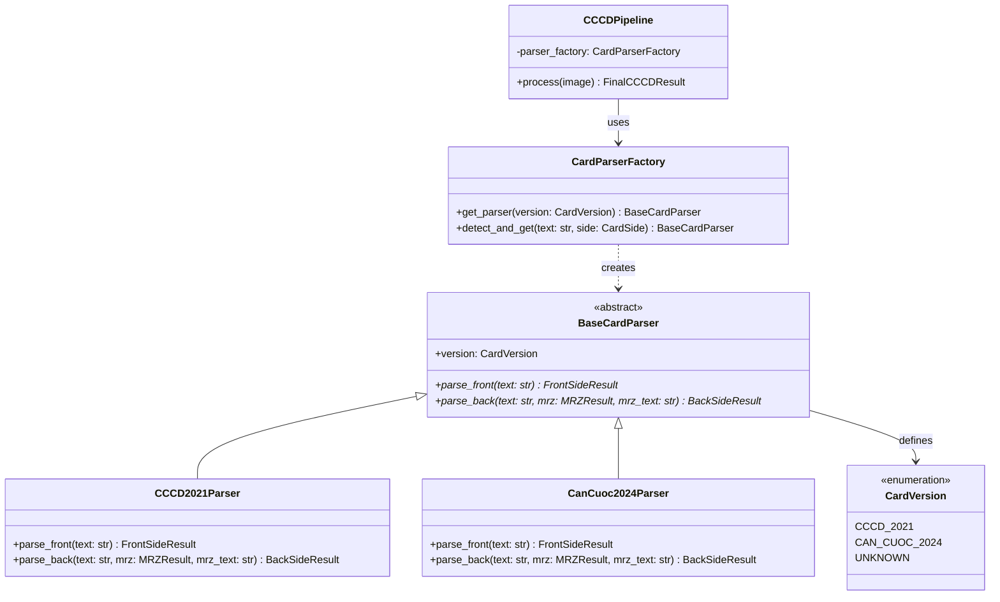
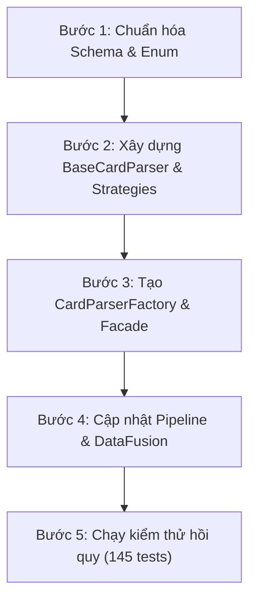

# Đề xuất Tái cấu trúc Hệ thống theo Hướng Đối tượng (OOP Refactoring Proposal)

Tài liệu này phân tích hiện trạng kiến trúc bóc tách thông tin căn cước công dân (CCCD 2021) và Thẻ Căn cước (2024), đồng thời đề xuất kế hoạch tái cấu trúc toàn diện theo phương pháp **Lập trình Hướng đối tượng (OOP)** kết hợp các **Mẫu thiết kế (Design Patterns)** chuẩn mực.

---

## 1. Phân tích Hiện trạng (Current State Analysis)

Hệ thống hiện tại hoạt động ổn định và vượt qua toàn bộ 145+ bài kiểm thử tự động, trước refactor, phần xử lý quy tắc nghiệp vụ (Parser) và hợp nhất (Fusion) được viết theo phong cách **Hướng thủ tục (Procedural Programming)** đặt trong các lớp tiện ích tĩnh (Utility Class).

### 1.1. Các vấn đề kiến trúc chính

| Vấn đề | Biểu hiện trong Code | Tác động tiêu cực |
|---|---|---|
| **Lạm dụng hàm tĩnh (`@classmethod` / `@staticmethod`)** | `FrontRuleExtractor`, `BackRuleExtractor`, `DataFusion` không lưu giữ trạng thái, không có instance thực sự. | Chưa có điểm inject strategy vào pipeline. Hàm tĩnh không tự nó là lỗi kiến trúc; cần instance khi thay thế thuật toán hoặc dependency. |
| **Phân nhánh thủ tục (`if/else branching`)** | Trong `vn_id/parser/back.py#L61-L187`, dùng cờ `if is_2024: ... else: ...`. | Code bị phình to (God Method), logic 2 phiên bản thẻ bị lồng ghép phức tạp. |
| **Vi phạm Open/Closed Principle (OCP)** | Muốn hỗ trợ thêm CMND 9 số, CMND 12 số hoặc CCCD mã vạch 2016 thì buộc phải sửa mã nguồn cũ. | Rủi ro gây lỗi hồi quy (regression bug) cho các phiên bản thẻ đã chạy ổn định. |
| **Mô hình dữ liệu phẳng (Flat Schema)** | `CCCDData` trong `vn_id/core/schemas.py` gom tất cả trường đặc thù của các thế hệ thẻ vào một class. | Thiếu tính bao đóng và định kiểu chặt chẽ; `card_version` chỉ là chuỗi `str` tự do thay vì `Enum`. |

---

## 2. Thiết kế Kiến trúc Mới (Proposed OOP Architecture)

Kiến trúc mới sẽ áp dụng hai mẫu thiết kế kinh điển:
1. **Strategy Pattern:** Đóng gói thuật toán trích xuất của từng phiên bản thẻ thành các class chiến lược độc lập kế thừa từ một Interface chung.
2. **Factory Pattern:** Tạo đối tượng Parser tương ứng dựa trên kết quả nhận diện phiên bản thẻ (`CardVersion`).



---

## 3. Cấu trúc Thư mục Đề xuất

```text
vn_id/
├── core/
│   ├── schemas.py             # Thêm CardVersion(str, Enum) vào schema kết quả
│   └── constants.py
├── parser/
│   ├── __init__.py            # Export CardParserFactory, BaseCardParser, FrontRuleExtractor (compat)
│   ├── base.py                # Abstract Base Class: BaseCardParser
│   ├── common.py              # Các hàm regex và chuẩn hóa chuỗi dùng chung
│   ├── mrz.py                 # Parser định dạng MRZ độc lập
│   ├── strategies/            # Các chiến lược xử lý theo phiên bản thẻ
│   │   ├── __init__.py
│   │   ├── cccd_2021.py       # CCCD2021Parser & UnknownCardParser
│   │   └── can_cuoc_2024.py   # CanCuoc2024Parser
│   └── factory.py             # CardParserFactory & Bộ nhận diện phiên bản thẻ
├── validator/
│   └── fusion.py              # DataFusion.merge instance + fuse facade
└── pipeline.py                # Gọi parser qua Factory & tính đa hình
```

---

## 4. Chi tiết Cài đặt Kỹ thuật

### 4.1. Định nghĩa Kiểu Liệt kê (Enum) Phiên bản Thẻ
Chuyển đổi kiểu dữ liệu từ chuỗi tự do sang `Enum` có kiểm tra kiểu tĩnh (Static Type Checking):

```python
# vn_id/core/schemas.py
from enum import Enum

class CardVersion(str, Enum):
    CCCD_2021 = "can_cuoc_cong_dan_2021"
    CAN_CUOC_2024 = "can_cuoc_2024"
    UNKNOWN = "unknown"

    def __str__(self) -> str:
        return self.value
```

### 4.2. Abstract Base Class (`BaseCardParser`)
Định nghĩa contract chuẩn cho mọi parser thẻ căn cước:

```python
# vn_id/parser/base.py
from abc import ABC, abstractmethod
from vn_id.core.schemas import CardVersion, FrontSideResult, BackSideResult, MRZResult
from vn_id.parser.common import parse_front_fields

class BaseCardParser(ABC):
    """Lớp trừu tượng định nghĩa giao diện trích xuất cho các mẫu thẻ định danh."""

    @property
    @abstractmethod
    def version(self) -> CardVersion:
        """Trả về định danh phiên bản thẻ của parser."""
        pass

    def parse_front(self, text: str) -> FrontSideResult:
        """Dùng chung rule mặt trước, cho phép strategy override khi cần."""
        return parse_front_fields(text, self.version)

    @abstractmethod
    def parse_back(
        self, text: str, mrz: MRZResult | None = None, *, mrz_text: str | None = None,
    ) -> BackSideResult:
        """Trích xuất thông tin mặt sau của thẻ."""
        pass
```

### 4.3. Các Concrete Strategy

#### A. Chiến lược Thẻ CCCD gắn chip 2021 (`CCCD2021Parser`)
- **Mặt trước:** Chứa Họ tên, Số CCCD, Ngày sinh, Giới tính, Quốc tịch, Quê quán, Nơi thường trú, Hạn sử dụng ("Có giá trị đến"), Mã QR.
- **Mặt sau:** Trích xuất Ngày cấp, Nơi cấp ("Cục Cảnh sát QLHC về TTXH"), Dãy MRZ.

```python
# vn_id/parser/strategies/cccd_2021.py
class CCCD2021Parser(BaseCardParser):
    version = CardVersion.CCCD_2021

    # Kế thừa parse_front dùng chung từ BaseCardParser.

    def parse_back(
        self, text: str, mrz: MRZResult | None = None, *, mrz_text: str | None = None,
    ) -> BackSideResult:
        # Bóc tách Ngày cấp, Nơi cấp = Cục Cảnh sát QLHC
        ...
```

#### B. Chiến lược Thẻ Căn cước 2024 (`CanCuoc2024Parser`)
- **Mặt trước:** Chỉ có Số định danh, Họ tên, Ngày sinh, Giới tính, Quốc tịch.
- **Mặt sau:** Nơi cư trú, Nơi đăng ký khai sinh, Ngày cấp ("Ngày, tháng, năm cấp"), Ngày hết hạn ("Ngày, tháng, năm hết hạn"), Nơi cấp ("Bộ Công an"), Mã QR, Dãy MRZ.

```python
# vn_id/parser/strategies/can_cuoc_2024.py
class CanCuoc2024Parser(BaseCardParser):
    version = CardVersion.CAN_CUOC_2024

    # Kế thừa parse_front dùng chung từ BaseCardParser.

    def parse_back(
        self, text: str, mrz: MRZResult | None = None, *, mrz_text: str | None = None,
    ) -> BackSideResult:
        # Bóc tách Nơi cư trú, Nơi ĐKKS, Ngày hết hạn, Nơi cấp = Bộ Công an
        ...
```

### 4.4. Factory và Bộ nhận diện phiên bản (`CardParserFactory`)

```python
# Registry thuộc từng instance; constructor cho phép thay strategy.
factory = CardParserFactory({CardVersion.CAN_CUOC_2024: CanCuoc2024Parser()})
parser = factory.detect_and_get(text, CardSide.BACK)
result = parser.parse_back(text, mrz_text=mrz_text)
```

`get_parser(version)` nhận enum hoặc giá trị chuỗi hợp lệ. `UNKNOWN` dùng `UnknownCardParser`, kế thừa rule phục hồi 2021 nhưng luôn trả `card_version=UNKNOWN`; không gán phiên bản 2021 chỉ vì chọn fallback. Giá trị ngoài enum bị từ chối. Bộ nhận diện giữ nguyên các dấu hiệu OCR hiện có.

### 4.5. Cơ chế Tương thích ngược (Backward Compatibility)
Để không phá vỡ mã nguồn hiện có và các bài kiểm thử:
- Giữ nguyên các facade `FrontRuleExtractor.extract(text)` và `BackRuleExtractor.extract(text, mrz_text)`.
- Bên trong các facade này, ủy quyền (delegate) cuộc gọi sang `CardParserFactory`:
  ```python
  class FrontRuleExtractor:
      @classmethod
      def extract(cls, text: str) -> FrontSideResult:
          version = CardParserFactory.detect_version(text, CardSide.FRONT)
          parser = CardParserFactory().get_parser(version)
          return parser.parse_front(text)
  ```

---

## 5. Lộ trình Thực hiện Từng bước (Implementation Roadmap)



1. **Bước 1: Chuẩn hóa Schema & Enum**
   - Thêm `CardVersion(str, Enum)` vào `vn_id/core/schemas.py`.
   - Kiểu `card_version` trên FrontSideResult, BackSideResult, FinalCCCDResult dùng enum; nhận các chuỗi hợp lệ và serialize JSON như trước. Giữ các alias schema hiện tại. Giá trị chuỗi không hợp lệ bị từ chối khi khởi tạo model.

2. **Bước 2: Tách biệt Strategy cho từng phiên bản**
   - Tạo thư mục `vn_id/parser/strategies/`.
   - Di chuyển và cô lập logic bóc tách của CCCD 2021 vào `CCCD2021Parser`.
   - Di chuyển và cô lập logic bóc tách của Căn cước 2024 vào `CanCuoc2024Parser`.

3. **Bước 3: Cài đặt Factory & Facade tương thích ngược**
   - Tạo `CardParserFactory`.
   - Cập nhật `FrontRuleExtractor` và `BackRuleExtractor` làm delegate facade.

4. **Bước 4: Cập nhật Pipeline và DataFusion**
   - Cho phép `CCCDPipeline` inject hoặc sử dụng Parser thông qua đa hình.
   - Thêm `DataFusion.merge()` instance và giữ `fuse()` facade. Tách giải quyết phiên bản sang `resolve_card_version()`. Giữ nguyên ưu tiên theo trường; chưa tạo fusion strategy theo phiên bản vì hai phiên bản dùng chung chính sách.

5. **Bước 5: Kiểm thử hồi quy toàn diện**
   - Đảm bảo 100% các unit test và integration test (`tests/`) tiếp tục vượt qua mà không cần sửa đổi test case của client.

---

## 6. Lợi ích Đạt được Sau khi Tái cấu trúc

| Tiêu chí | Trước khi Refactor | Sau khi Refactor (OOP) |
|---|---|---|
| **Khả năng mở rộng (Extensibility)** | Khó khăn, phải sửa trực tiếp hàm `if/else` dài hàng trăm dòng. | Dễ dàng, chỉ cần tạo file class mới kế thừa `BaseCardParser` và đăng ký vào Factory. |
| **Tính đóng gói (Encapsulation)** | Logic thẻ 2021 và 2024 lẫn lộn trong cùng một hàm. | Từng phiên bản thẻ độc lập, dễ bảo trì, thay đổi thẻ 2024 không ảnh hưởng thẻ 2021. |
| **Khả năng kiểm thử (Testability)** | Khó test riêng từng bộ rule của từng thẻ. | Có thể viết Unit Test chuyên biệt cho từng Parser Class mà không cần giả lập toàn bộ pipeline. |
| **Độ rõ ràng của mã nguồn (Readability)** | Nhiều nhánh regex phức tạp lồng nhau. | Cấu trúc phân tầng rõ ràng, chuẩn phong cách Pythonic và Clean Architecture. |


## 7. Kết quả review và phạm vi triển khai (12/10/2026)

- Dùng Strategy/Factory cho các bố cục mặt sau thực sự khác nhau. Mặt trước kế thừa rule chung từ BaseCardParser để bảo toàn các heuristic OCR và tránh nhân đôi code.
- Giữ schema dữ liệu hợp nhất `CCCDData` hiện tại. Tách schema theo thế hệ sẽ đổi contract API và không cần thiết cho refactor này.
- Không đoán phiên bản từ fallback; xung đột hai mặt vẫn trả `unknown` kèm cảnh báo. Mỗi mặt được nhận diện riêng để không che giấu bất đồng.
- Giữ cả MRZResult đã parse và `mrz_text` từ crop OCR. Facade cũ vẫn nhận `mrz_text` làm tham số thứ hai.
- Factory là instance có registry riêng, pipeline nhận keyword `parser_factory` và `fusion`. Loại bỏ registry dùng chung ở class để tránh rò cấu hình giữa các pipeline.
- Fusion tiếp tục dùng các quy tắc ưu tiên theo trường, nguồn dữ liệu và kiểm tra MRZ hiện tại. Instance `merge()` cho phép inject/override; không nhân đôi thuật toán chung thành hai strategy.
- Kiểm thử: giữ nguyên toàn bộ tests client; bổ sung tests enum/JSON, strategy độc lập, unknown, MRZ, registry riêng và injection ở cả ba luồng pipeline. Chạy suite đầy đủ, gồm tests ảnh thật khi đủ model/fixture.

### Xác minh sau triển khai

`OMP_NUM_THREADS=4 MKL_NUM_THREADS=4 .venv/bin/python -m pytest -q`: **157 passed, 2 skipped**; 39 cảnh báo dependency/runtime đã có ở baseline. Toàn bộ tests client cũ giữ nguyên. Kết quả parser khớp bản cũ trên 52 đầu vào text trích từ tests; `compileall` và `git diff --check` đạt. Review độc lập không phát hiện lỗi đáng kể.
