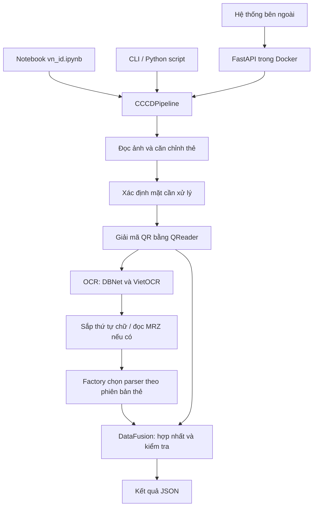

# Báo cáo hệ thống trích xuất thông tin Căn cước VN_ID

Tài liệu mô tả kiến trúc, luồng xử lý và cách vận hành hệ thống VN_ID; đồng thời cung cấp quy cách đầu vào, đầu ra để các hệ thống khác tích hợp qua API chạy trong Docker.

## 1. Mục tiêu và phạm vi

VN_ID nhận ảnh thẻ, đọc chữ bằng OCR, giải mã QR và phân tích MRZ để tạo dữ liệu JSON có cấu trúc. Hệ thống hỗ trợ CCCD gắn chip mẫu 2021 và thẻ Căn cước mẫu 2024, xử lý một mặt hoặc đồng thời hai mặt của cùng một thẻ.

Các nhóm thông tin có thể trích xuất gồm số căn cước, họ tên, ngày sinh, giới tính, quê quán/nơi đăng ký khai sinh, nơi thường trú/nơi cư trú, ngày cấp, nơi cấp, ngày hết hạn và một số thông tin trong QR. Mức độ đầy đủ phụ thuộc loại thẻ, mặt ảnh được cung cấp và chất lượng ảnh.

Hệ thống kiểm tra cấu trúc dữ liệu và đối chiếu một số nguồn trên thẻ; không kết nối cơ sở dữ liệu dân cư để xác minh danh tính hoặc tính xác thực của thẻ.

## 2. Kiến trúc hệ thống

### 2.1. Kiến trúc tổng thể

Notebook, CLI và REST API cùng sử dụng lớp điều phối `CCCDPipeline`. Docker đóng gói thư viện và REST API để triển khai dịch vụ; bên tích hợp chỉ cần gửi ảnh qua HTTP.



Sơ đồ thể hiện các thành phần và quan hệ dữ liệu. Pipeline hiện gọi các bước xử lý tuần tự; hai mặt cũng được xử lý lần lượt.

### 2.2. Các thành phần chính

| Thành phần | Vị trí | Vai trò |
|---|---|---|
| Điều phối | `vn_id/pipeline.py` | Kết nối các bước; hỗ trợ một ảnh hoặc hai mặt; ghi thời gian xử lý |
| Schema | `vn_id/core/schemas.py` | Định nghĩa dữ liệu trung gian và kết quả bằng Pydantic |
| Căn chỉnh và phân loại mặt | `vn_id/aligner/` | Tìm vùng thẻ, nắn phối cảnh, phân loại mặt dựa trên chữ OCR |
| OCR | `vn_id/ocr/` | EasyOCR/DBNet18 tìm vùng chữ; VietOCR đọc tiếng Việt; sắp thứ tự dòng |
| QR | `vn_id/qr/` | QReader phát hiện, giải mã và tách thông tin từ QR |
| Parser | `vn_id/parser/` | Trích xuất trường bằng quy tắc chuỗi/regex, phân tích MRZ |
| Hợp nhất và kiểm tra | `vn_id/validator/` | Chọn nguồn từng trường, chuẩn hóa và kiểm tra dữ liệu |
| REST API | `vn_id/api/app.py` | Nhận ảnh qua HTTP và trả JSON |
| CLI | `vn_id/cli/main.py` | Chạy trích xuất từ dòng lệnh |

Parser dùng Factory/Strategy: `CardParserFactory` nhận diện phiên bản để chọn `CCCD2021Parser`, `CanCuoc2024Parser` hoặc `UnknownCardParser`. Cách tổ chức này tách quy tắc của từng bố cục thẻ, đồng thời giữ chung schema đầu ra cho bên sử dụng.

### 2.3. Đặc điểm theo phiên bản thẻ

| Phiên bản | Mặt trước | Mặt sau |
|---|---|---|
| CCCD 2021 | Thông tin nhân thân, quê quán, thường trú, hạn dùng; QR | Ngày cấp, nơi cấp, MRZ |
| Căn cước 2024 | Thông tin nhân thân | Nơi đăng ký khai sinh, nơi cư trú, ngày cấp, hạn dùng, nơi cấp, QR và MRZ |

Cả hai mẫu đều có MRZ. Hệ thống dựa vào tiêu đề và nhãn bố cục để nhận diện phiên bản. Nếu không đủ bằng chứng, hoặc hai mặt xác định hai phiên bản khác nhau, kết quả có thể là `unknown`; xung đột hai mặt được ghi vào cảnh báo.

## 3. Luồng hoạt động

### 3.1. Xử lý một ảnh

1. **Đọc ảnh:** lớp Python nhận đường dẫn, bytes hoặc NumPy array; API nhận bytes từ file upload và giải mã bằng OpenCV.
2. **Căn chỉnh:** tìm góc thẻ và nắn về kích thước chuẩn 1000 × 630. Nếu không tìm được góc tin cậy, hệ thống resize toàn ảnh.
3. **Xác định mặt:** nếu người gọi Python/CLI đã chỉ định mặt thì dùng chỉ định đó. API một ảnh tự phân loại bằng OCR sơ bộ; nếu không xác định được thì mặc định mặt trước.
4. **Đọc QR:** thử vùng QR trên ảnh đã căn, sau đó thử ảnh gốc nếu chưa giải mã được.
5. **OCR:** che vùng QR trên bản sao ảnh; DBNet18 phát hiện vùng chữ, VietOCR nhận dạng chữ và bộ sắp dòng tạo văn bản theo thứ tự đọc. Với mặt sau, hệ thống có thể đọc riêng vùng MRZ bằng EasyOCR với bộ ký tự phù hợp.
6. **Trích xuất:** chọn parser theo phiên bản và mặt thẻ, lấy các trường thông tin; phân tích MRZ và kiểm tra checksum nếu có.
7. **Hợp nhất:** chọn nguồn cho từng trường, bổ sung dữ liệu còn thiếu, chuẩn hóa Unicode NFC và định dạng đầu ra.
8. **Kiểm tra và trả kết quả:** kiểm tra cấu trúc số căn cước, đối chiếu với ngày sinh/giới tính và MRZ; trả dữ liệu, nguồn từng trường, cảnh báo và thời gian xử lý.

### 3.2. Xử lý hai mặt

Người gọi cung cấp đúng ảnh mặt trước và mặt sau của cùng một thẻ. Pipeline đọc mặt trước, sau đó mặt sau, rồi hợp nhất thành một hồ sơ. Nếu chưa đọc được QR ở mặt trước, pipeline tiếp tục tìm QR trên mặt sau; điều này hỗ trợ bố cục Căn cước 2024.

API hai mặt sử dụng vai trò `front` và `back` do bên gửi chỉ định. Bên gửi cần gán đúng ảnh vào từng trường.

### 3.3. Quy tắc ưu tiên dữ liệu

| Trường | Thứ tự ưu tiên |
|---|---|
| `id`, `dob`, `gender` | QR → chữ mặt trước → MRZ cho phần còn thiếu |
| `name` | QR → chữ mặt trước |
| `gender` khi vẫn thiếu | Suy ra từ chữ số thứ tư của ID 12 chữ số |
| `origin` | Chữ mặt trước → chữ mặt sau |
| `residence` | QR → chữ mặt trước → chữ mặt sau |
| `issue_date` | Chữ mặt sau → QR |
| `issue_loc` | Chữ mặt sau |
| `expiry_date` | Chữ mặt trước → chữ mặt sau → MRZ cho phần còn thiếu |
| `cmnd_old`, `father_name`, `mother_name` | QR nếu có |
| `nationality` | Giá trị mặc định `Việt Nam` |

Đây là quy tắc chọn nguồn. QR có thể chứa dữ liệu sai; nguồn ưu tiên không đồng nghĩa với độ chính xác tuyệt đối. Đối chiếu MRZ được ghi riêng trong `validation`.

## 4. Môi trường và cách chạy trực tiếp

### 4.1. Phiên bản Python

**Yêu cầu triển khai của dự án: VietOCR chỉ chạy với Python 3.12 trở về trước; ưu tiên Python 3.12.** Với phiên bản dự án hiện tại, chọn Python 3.10–3.12 theo yêu cầu tối thiểu trong `pyproject.toml`; môi trường khuyến nghị là **Python 3.12**.

Notebook cố định Python **3.12.3**, Docker dùng base image **Python 3.12**. Không chạy các thư viện OCR trực tiếp trong kernel Python 3.13 trở lên. Dù metadata hiện chỉ khai báo `requires-python >=3.10`, khi cài đặt vẫn cần chủ động chọn Python 3.12.

### 4.2. Cài đặt và chạy bằng Python/CLI

Chạy các lệnh tại thư mục gốc repository. Máy Linux cần thư viện hệ thống cho QR/OpenCV; tham khảo danh sách trong Dockerfile.

```bash
sudo apt-get update
sudo apt-get install -y libzbar0 libgl1 libglib2.0-0 libgomp1
uv python install 3.12
uv sync --locked --python 3.12
uv run python --version
```

Chạy một mặt hoặc hai mặt và lưu JSON:

```bash
mkdir -p output
uv run vn-id extract --front image/front_cu_2.png --device cpu \
  -o output/front_cu_2.json
uv run vn-id extract --front image/front_moi_1.jpg \
  --back image/back_moi_1.jpg -o output/both.json
```

Sử dụng từ Python:

```python
from vn_id import CCCDPipeline, CardSide

pipeline = CCCDPipeline(device="auto")
result = pipeline.process("image/front_cu_2.png", force_side=CardSide.FRONT)
print(result.model_dump_json(indent=2))
```

`auto` chọn CUDA khi PyTorch nhận GPU, nếu không thì chạy CPU. Giữ cùng instance `pipeline` để tái sử dụng model qua nhiều ảnh. Lượt đầu có thể cần mạng để tải trọng số và thường chậm hơn các lượt tiếp theo.

## 5. Sử dụng notebook `vn_id.ipynb`

### 5.1. Mô hình thực thi

Notebook hiện được thiết kế cho Google Colab, dùng các đường dẫn `/content/...` và lệnh cài đặt của môi trường Colab. Kernel giao diện có thể là Python 3.13, nhưng toàn bộ OCR, QR và PyTorch chạy trong process Python 3.12.3 riêng tại `/content/venv312/bin/python`.

Process này giữ `CCCDPipeline` và model giữa các lần chạy cell xử lý. Không cần cài VietOCR vào kernel giao diện để chạy pipeline.

### 5.2. Trình tự sử dụng

1. Mở `vn_id.ipynb` trên Colab; chọn GPU runtime nếu muốn chạy CUDA.
2. Chạy mục **1** để cài Python 3.12.3 và tạo `/content/venv312`.
3. Chạy mục **2** để clone repository, cài thư viện hệ thống và dependency. Cell clone hiện chọn nhánh `test`; khi trình diễn hoặc bàn giao, kiểm tra nhánh/commit cần sử dụng. Nếu thư mục đã tồn tại, cell không tự cập nhật mã nguồn.
4. Chạy mục **3** để kiểm tra đúng Python 3.12.3 và trạng thái CUDA trong môi trường pipeline.
5. Chạy mục **4** để ghi script `/content/run_vnid_pipeline.py` và chuẩn bị trọng số theo các cell đi kèm.
6. Tại mục **5**, đặt `FRONT_IMAGE` và `BACK_IMAGE` tới ảnh đã có trên Colab.
7. Chạy mục **6** để thực hiện OCR. Lần đầu tạo process và load model; các lần sau dùng lại process/model.
8. Xem preview ở mục **7**, JSON ở mục **8**.

Ví dụ chỉ chạy mặt trước:

```python
FRONT_IMAGE = "/content/VN_ID/image/front_cu_2.png"
BACK_IMAGE = ""
```

Để chạy một mặt sau, đặt `FRONT_IMAGE = ""` và điền `BACK_IMAGE`. Để chạy hai mặt, điền cả hai đường dẫn. Cả hai chuỗi rỗng sẽ báo lỗi.

Notebook có các cell cài compiler/Ninja và patch EasyOCR từ quá trình thử nghiệm. Source hiện có lớp tương thích DBNet dùng toán tử `torchvision`, nên các bước patch extension không phải yêu cầu của Docker hiện tại. Notebook cài thêm dependency ngoài `uv.lock`; kết quả môi trường có thể khác bản Docker đã khóa dependency.

### 5.3. Đầu ra và chạy lại

| Đầu ra | Vị trí |
|---|---|
| Kết quả JSON | `/content/vnid_output/output_result.json` |
| Preview ảnh đầu vào | `/content/vnid_output/input_preview.png` |
| Log và bảng trường thông tin | Output của cell mục 6 |

Các file cùng tên được ghi lại ở lượt tiếp theo; tải về hoặc đổi tên nếu cần giữ từng kết quả. Preview chỉ hiển thị ảnh đầu vào, không phải ảnh chú thích vùng OCR.

Khi đổi ảnh, chạy lại cell chọn ảnh rồi cell mục 6. Sau khi sửa mã nguồn, dừng worker để lượt tiếp theo nạp lại code:

```python
vnid_worker.terminate()
vnid_worker.wait()
```

Restart/disconnect runtime có thể làm mất process và dữ liệu trong `/content`; cần chuẩn bị lại môi trường khi runtime bị thay mới.

`total_ms` là thời gian nội bộ pipeline; `pipeline_wall_ms` đo lời gọi pipeline có đồng bộ CUDA; `cell_wall_ms` đo cả yêu cầu và các thao tác preview/in kết quả. Đây là các phạm vi đo lồng nhau, không cộng ba giá trị.

## 6. Triển khai Docker và REST API

### 6.1. Đóng gói

Dockerfile dùng Python 3.12, cài package cùng dependency từ `uv.lock` và khởi động Uvicorn trên cổng container `8000`, một worker. Container chạy bằng user `app`.

Ảnh CCCD, notebook, kết quả JSON và trọng số local không được đưa vào image. Volume gắn tại `/home/app/.cache` giữ cache model qua các lần khởi động. Image mới chưa có sẵn toàn bộ trọng số để chạy ngoại tuyến.

### 6.2. Build và chạy trên GPU

Máy triển khai cần Docker Engine, NVIDIA driver và NVIDIA Container Toolkit phù hợp. Build image không yêu cầu GPU.

```bash
docker build -t vn-id:0.1.0-gpu .
docker compose up -d
docker compose logs -f vn-id
```

`compose.yaml` yêu cầu GPU và kiểm tra CUDA khi khởi động; không có GPU sẽ dừng service. Kiểm tra thiết bị:

```bash
docker compose exec vn-id python -c 'import torch; assert torch.cuda.is_available(); print(torch.cuda.get_device_name(0))'
curl --fail http://127.0.0.1:8000/health
```

### 6.3. Chạy trên máy CPU

Dùng cùng image nhưng chạy trực tiếp, vì cấu hình Compose hiện yêu cầu GPU:

```bash
docker run -d --name vn-id-cpu \
  -p 127.0.0.1:8000:8000 \
  -v vn-id-model-cache:/home/app/.cache \
  vn-id:0.1.0-gpu
```

Pipeline tự chọn CPU nếu CUDA không khả dụng. Dừng và xóa container thử nghiệm bằng `docker stop vn-id-cpu` rồi `docker rm vn-id-cpu`; volume vẫn được giữ.

### 6.4. Cache và trọng số

Lượt inference đầu cần mạng nếu chưa có model và có thể mất nhiều thời gian hơn do tải trọng số. Có thể đưa model local vào service Compose trước request đầu:

```bash
docker compose cp .easyocr_models/model/. vn-id:/home/app/.cache/vn_id/.easyocr_models/model/
docker compose cp .models/qrdet/. vn-id:/home/app/.cache/vn_id/.models/qrdet/
docker compose exec --user root vn-id chown -R app:app /home/app/.cache
```

Model còn thiếu vẫn có thể được tải lúc chạy. Muốn vận hành ngoại tuyến, cần chuẩn bị đủ cache và thử inference trong điều kiện ngắt mạng. `docker compose down` giữ volume; `docker compose down -v` xóa volume cache.

### 6.5. Địa chỉ dịch vụ

| Mục đích | URL khi chạy trên cùng máy |
|---|---|
| Kiểm tra dịch vụ | `http://127.0.0.1:8000/health` |
| Swagger UI | `http://127.0.0.1:8000/docs` |
| OpenAPI schema | `http://127.0.0.1:8000/openapi.json` |
| Trích xuất một ảnh | `http://127.0.0.1:8000/api/v1/extract` |
| Trích xuất hai mặt | `http://127.0.0.1:8000/api/v1/extract-both` |

Cấu hình hiện chỉ publish trên loopback `127.0.0.1`. Để bên khác gọi từ máy khác, bên triển khai cần cung cấp hostname/IP truy cập được, chẳng hạn qua reverse proxy, hoặc thay port mapping thành `8000:8000` theo môi trường mạng. Bên tích hợp dùng URL được bàn giao thay cho `127.0.0.1`. API hiện chưa có xác thực tích hợp sẵn; cơ chế kiểm soát truy cập do lớp triển khai quản lý.

Có thể chạy cùng API ngoài Docker bằng môi trường Python 3.12 đã cài:

```bash
uv run uvicorn vn_id.api.app:app --host 127.0.0.1 --port 8000 --workers 1
```

## 7. Quy cách đầu vào API cho bên tích hợp

### 7.1. Quy ước chung

- Phương thức trích xuất: **POST** với body **`multipart/form-data`**.
- Mỗi trường file chứa bytes của ảnh; dùng ảnh JPEG/PNG mà OpenCV đọc được.
- Gửi file thực tế, không gửi chuỗi đường dẫn trên máy client, JSON base64 hoặc URL ảnh.
- Một request xử lý một ảnh hoặc một cặp hai mặt. API hiện không nhận danh sách ảnh theo batch.
- Với hai mặt, ảnh phải thuộc cùng một thẻ. Ảnh nên rõ chữ, đủ vùng thẻ và hạn chế chói/mờ.
- Client HTTP tự tạo `Content-Type` kèm multipart boundary; không tự gán `application/json` cho request upload.

### 7.2. Một ảnh: `POST /api/v1/extract`

| Trường form | Kiểu | Bắt buộc | Ý nghĩa |
|---|---|---|---|
| `file` | File nhị phân | Có | Ảnh mặt trước hoặc mặt sau |

Endpoint tự phân loại mặt và mặc định mặt trước khi không chắc. API hiện không có tham số `force_side`; nếu cần chỉ định mặt cho một ảnh, lớp Python/CLI có hỗ trợ riêng.

```bash
curl --fail-with-body \
  -F "file=@image/front_cu_2.png" \
  http://127.0.0.1:8000/api/v1/extract \
  -o response_single.json
```

`response_single.json` được lưu trên máy chạy `curl`. Không cần mount ảnh vào container vì file đã được truyền qua HTTP.

### 7.3. Hai mặt: `POST /api/v1/extract-both`

| Trường form | Kiểu | Bắt buộc | Ý nghĩa |
|---|---|---|---|
| `front` | File nhị phân | Có | Ảnh mặt trước |
| `back` | File nhị phân | Có | Ảnh mặt sau |

```bash
curl --fail-with-body \
  -F "front=@image/front_moi_1.jpg" \
  -F "back=@image/back_moi_1.jpg" \
  http://127.0.0.1:8000/api/v1/extract-both \
  -o response_both.json
```

### 7.4. Ví dụ client Python

Máy client chỉ cần thư viện HTTP, không cần cài model OCR hoặc Python 3.12 cho server:

```python
import json
import httpx

base_url = "http://127.0.0.1:8000"  # Thay bằng URL dịch vụ được bàn giao.

with open("front.jpg", "rb") as front, open("back.jpg", "rb") as back:
    response = httpx.post(
        f"{base_url}/api/v1/extract-both",
        files={
            "front": ("front.jpg", front, "image/jpeg"),
            "back": ("back.jpg", back, "image/jpeg"),
        },
        timeout=300.0,
    )

response.raise_for_status()
result = response.json()
with open("result.json", "w", encoding="utf-8") as output:
    json.dump(result, output, ensure_ascii=False, indent=2)

if not result["success"]:
    print("Chưa trích xuất được dữ liệu tối thiểu; cần kiểm tra ảnh.")
else:
    print(result["data"])
print("Cảnh báo:", result["validation"]["warnings"])
```

Timeout 300 giây là ví dụ cấu hình phía client, cần điều chỉnh theo máy triển khai và chi phí tải model lần đầu. API xử lý đồng bộ và trả kết quả ngay trong response, không trả mã job để truy vấn sau.

## 8. Quy cách đầu ra

### 8.1. Cấu trúc JSON

Hai endpoint trích xuất cùng trả schema `FinalCCCDResult`, với `Content-Type: application/json`.

| Trường | Kiểu | Ý nghĩa |
|---|---|---|
| `success` | boolean | Có ít nhất một trong các trường `id`, `name`, `issue_date`, `issue_loc` |
| `card_version` | string | `can_cuoc_cong_dan_2021`, `can_cuoc_2024` hoặc `unknown` |
| `side_detected` | array[string] | Mặt đã xử lý: `front`, `back`, hoặc cả hai |
| `data` | object | Các trường thông tin hợp nhất |
| `field_sources` | object | Nguồn dữ liệu của từng trường đã được gán |
| `validation` | object | Kết quả kiểm tra và cảnh báo |
| `timings` | object | Thời gian xử lý từng bước, đơn vị mili giây |

### 8.2. Các trường trong `data`

| Trường | Ý nghĩa |
|---|---|
| `id` | Số căn cước; kiểu chuỗi để giữ số 0 đầu |
| `cmnd_old` | Số CMND cũ nếu có trong QR |
| `name` | Họ tên, được chuyển thành chữ hoa |
| `dob` | Ngày sinh, định dạng chuẩn `DD/MM/YYYY` khi trích xuất được |
| `gender` | Giới tính |
| `nationality` | Hiện được gán mặc định `Việt Nam` |
| `origin` | Quê quán hoặc nơi đăng ký khai sinh |
| `residence` | Nơi thường trú hoặc nơi cư trú |
| `issue_date` | Ngày cấp |
| `expiry_date` | Ngày hết hạn hoặc giá trị biểu thị hạn dùng mà parser đọc được |
| `issue_loc` | Nơi cấp |
| `father_name`, `mother_name` | Thông tin cha/mẹ nếu QR cung cấp |

Các trường trên là chuỗi hoặc `null`, riêng `nationality` hiện luôn có giá trị mặc định. Không ép số căn cước sang kiểu số. Các ngày được chuẩn hóa về `DD/MM/YYYY` khi parser đọc được ngày cụ thể; không giả định mọi giá trị hạn dùng đều là một ngày.

Nguồn trong `field_sources` có thể là `qr`, `front_rules`, `back_rules`, `mrz`, `id_deduced`, `default`. Trường còn thiếu thường không có entry nguồn tương ứng.

### 8.3. Validation và ý nghĩa thành công

Điều kiện hiện tại:

```python
success = bool(data.id or data.name or data.issue_date or data.issue_loc)
```

Chỉ đọc được họ tên hoặc nơi cấp cũng trả `success: true`. Chỉ đọc được ngày sinh/địa chỉ mà thiếu cả bốn trường trên vẫn trả `success: false`. `success` không yêu cầu đầy đủ các trường và không phụ thuộc việc validation có đạt hay không.

| Trường validation | Ý nghĩa và giới hạn |
|---|---|
| `is_valid_12_digits` | ID có đúng 12 chữ số |
| `province_valid` | Mã tỉnh trong ID thuộc danh mục nội bộ |
| `gender_century_valid` | Đối chiếu chữ số giới tính/thế kỷ với dữ liệu có được |
| `birth_year_valid` | Đối chiếu hai chữ số năm sinh trong ID với ngày sinh |
| `address_fuzzy_score` | Hiện được đặt `1.0`, không phải điểm chính xác địa chỉ đã đo |
| `mrz_checks` | Kết quả đối chiếu các trường MRZ với nguồn đã chọn |
| `mrz_checksums` | Kết quả checksum MRZ; có thể `null` nếu không đủ dữ liệu kiểm tra |
| `warnings` | Danh sách cảnh báo cấu trúc hoặc mâu thuẫn dữ liệu |

Các cờ đối chiếu có thể giữ giá trị mặc định khi thiếu dữ liệu để kiểm tra. Object MRZ rỗng không có nghĩa đã xác thực MRZ thành công. Bên tích hợp cần kiểm tra các trường bắt buộc theo nghiệp vụ cùng nguồn và cảnh báo; `success: true` hoặc `warnings: []` chưa chứng minh toàn bộ dữ liệu chính xác.

### 8.4. Ví dụ response khi trích xuất cả hai mặt

Ví dụ dưới đây là response của `POST /api/v1/extract-both`, minh họa trường hợp xử lý mặt trước và mặt sau của cùng một thẻ CCCD 2021. Ví dụ giả định giải mã QR thành công; riêng ngày cấp lấy từ QR do OCR mặt sau chưa trích xuất được trường này. Dữ liệu và thời gian đều giả lập để trình bày schema. Ngày hết hạn được giữ theo thông tin trên thẻ; hệ thống hiện chưa kiểm tra thẻ còn hạn tại thời điểm gọi API.

```json
{
  "success": true,
  "card_version": "can_cuoc_cong_dan_2021",
  "side_detected": [
    "front",
    "back"
  ],
  "data": {
    "id": "001200000001",
    "cmnd_old": null,
    "name": "NGUYỄN VĂN A",
    "dob": "01/01/2000",
    "gender": "Nam",
    "nationality": "Việt Nam",
    "origin": "Phường Cống Vị, Quận Ba Đình, Hà Nội",
    "residence": "Phường Điện Biên, Quận Ba Đình, Hà Nội",
    "issue_date": "01/06/2021",
    "expiry_date": "01/01/2025",
    "issue_loc": "Cục Cảnh sát Quản lý hành chính về trật tự xã hội",
    "father_name": null,
    "mother_name": null
  },
  "field_sources": {
    "id": "qr",
    "name": "qr",
    "dob": "qr",
    "gender": "qr",
    "nationality": "default",
    "origin": "front_rules",
    "residence": "qr",
    "expiry_date": "front_rules",
    "issue_date": "qr",
    "issue_loc": "back_rules"
  },
  "validation": {
    "is_valid_12_digits": true,
    "province_valid": true,
    "gender_century_valid": true,
    "birth_year_valid": true,
    "address_fuzzy_score": 1.0,
    "mrz_checks": {
      "id": true,
      "dob": true,
      "gender": true,
      "expiry_date": true
    },
    "mrz_checksums": {
      "document_number": true,
      "personal_number": true,
      "dob": true,
      "expiry_date": true,
      "composite": null
    },
    "warnings": []
  },
  "timings": {
    "front_align_ms": 10.0,
    "qr_ms": 100.0,
    "front_ocr_det_ms": 500.0,
    "front_ocr_rec_ms": 200.0,
    "front_ocr_sort_ms": 1.0,
    "front_ocr_ms": 750.0,
    "front_rules_ms": 1.0,
    "back_align_ms": 10.0,
    "back_ocr_det_ms": 400.0,
    "back_ocr_rec_ms": 200.0,
    "back_ocr_sort_ms": 1.0,
    "back_ocr_ms": 650.0,
    "back_rules_ms": 1.0,
    "fusion_ms": 0.1,
    "total_ms": 1530.0
  }
}
```

`side_detected` chứa cả `front` và `back`. Trong ví dụ, `id`, `name`, `dob`, `gender`, `residence` và `issue_date` lấy từ `qr`; `origin` và `expiry_date` lấy từ `front_rules`; `issue_loc` lấy từ `back_rules`. Nếu OCR mặt sau cũng đọc được ngày cấp, quy tắc hợp nhất hiện tại ưu tiên `back_rules` cho `issue_date`. Các trường `cmnd_old`, `father_name`, `mother_name` cũng có thể lấy từ QR nếu payload cung cấp; trong ví dụ chúng là `null` nên không ghi nguồn. `nationality` vẫn là giá trị `default`. Các giá trị `mrz_checks: true` minh họa việc MRZ mặt sau khớp dữ liệu đã chọn; checksum `composite: null` biểu thị chưa đủ dữ liệu để kiểm tra checksum tổng hợp.

`front_ocr_ms` và `back_ocr_ms` bao gồm các công đoạn OCR của từng mặt; `total_ms` bao gồm cả pipeline. Không cộng tất cả khóa thời gian vì có các khoảng đo bao hàm nhau. Thời gian tìm QR ở mặt sau, nếu có, được cộng vào `qr_ms`.

### 8.5. HTTP status và lỗi

| HTTP status | Tình huống | Cách xử lý phía client |
|---|---|---|
| `200` | Pipeline hoàn tất và trả schema kết quả, kể cả `success: false` | Kiểm tra `success`, dữ liệu bắt buộc và `validation` |
| `400` | Bytes upload rỗng hoặc không giải mã được thành ảnh | Kiểm tra file đầu vào |
| `422` | Thiếu trường bắt buộc hoặc request không đúng kiểu FastAPI yêu cầu | Kiểm tra tên trường và multipart body |
| `500` | Lỗi runtime chưa được bắt | Kiểm tra log dịch vụ và tài nguyên máy |

Ví dụ lỗi ảnh không hợp lệ:

```json
{
  "detail": "Could not decode image from provided bytes."
}
```

Lỗi HTTP dùng body lỗi của FastAPI, không bảo đảm có `success` hoặc `data`. `GET /health` trả `status`, `version`, `device`; endpoint này kiểm tra dịch vụ và thiết bị được chọn, chưa kiểm tra inference OCR thành công. Cần gửi một ảnh thật để kiểm tra toàn bộ luồng.

## 9. Mức sử dụng phần cứng và thời gian inference

### 9.1. Kết quả thử nghiệm trên Google Colab

Theo kết quả chạy thử do người thực hiện dự án ghi nhận trên Google Colab với GPU NVIDIA T4, hệ thống có mức sử dụng bộ nhớ GPU và thời gian xử lý như sau:

| Tiêu chí | Kết quả ghi nhận |
|---|---|
| Môi trường chạy | Google Colab |
| GPU | NVIDIA T4 |
| Bộ nhớ GPU sử dụng | Khoảng **2,5 GB VRAM** |
| Đầu vào mỗi lượt | Một cặp ảnh mặt trước và mặt sau của cùng một thẻ |
| Thời gian inference hai mặt | Khoảng **3,5–5 giây/cặp ảnh** |

Mức 2,5 GB thể hiện dung lượng bộ nhớ GPU sử dụng trong lần thử, không phải tỷ lệ sử dụng năng lực tính toán GPU. Thời gian 3,5–5 giây là thời gian xử lý cả cặp ảnh hai mặt qua pipeline, không phải thời gian cho riêng từng mặt.

### 9.2. Phạm vi đánh giá

Các số liệu trên là kết quả quan sát trong môi trường thử nghiệm Colab T4. Chưa có thống kê số lượt đo, phân vị độ trễ hoặc số liệu CPU/RAM kèm theo; vì vậy đây là mức tham khảo cho báo cáo, chưa phải cam kết hiệu năng khi triển khai Docker/API hoặc khi có nhiều request đồng thời.

Khi so sánh các lần chạy, cần phân biệt lượt đầu khởi tạo/tải model với lượt tái sử dụng model. Notebook hiện giữ process và model giữa các lần chạy; nên báo cáo riêng hai trường hợp này. Số liệu được cung cấp chưa xác định rõ lấy từ `total_ms`, `pipeline_wall_ms` hay `cell_wall_ms`; khi đo bổ sung trên GPU, ưu tiên `pipeline_wall_ms` có đồng bộ CUDA để đánh giá thời gian pipeline và ghi riêng độ trễ HTTP nếu kiểm thử API.

Thời gian thực tế có thể thay đổi theo kích thước và chất lượng ảnh, số vùng chữ, khả năng giải mã QR, trạng thái model/cache và tài nguyên runtime được cấp. Để xác định cấu hình phục vụ, cần đo thêm trên máy triển khai với tải yêu cầu thực tế.

## 10. Lưu ý vận hành và bàn giao

- Khi bàn giao API, cung cấp base URL, endpoint, tên trường multipart, ví dụ response và các trường nghiệp vụ bắt buộc. Client không cần truy cập filesystem container.
- API hiện trả JSON trong HTTP response, không tự lưu file kết quả cho từng request. Client tự lưu response; thư mục output ở notebook/CLI thuộc cơ chế chạy riêng.
- Giữ volume model để giảm chi phí tải lại. Môi trường Docker khóa dependency bằng `uv.lock`; trọng số tải lúc chạy cần được quản lý riêng nếu muốn tái lập đầy đủ.
- Một worker vẫn có thể nhận nhiều request đồng thời; ứng dụng hiện chưa có hàng đợi hoặc giới hạn số inference đồng thời. Cần đo tải trên máy đích trước khi xác định năng lực phục vụ.
- Ảnh mờ, chói, thiếu góc hoặc sai thứ tự mặt có thể làm thiếu/sai dữ liệu. Quốc tịch mặc định và các cờ validation không thay thế việc kiểm tra trường thông tin thực tế.
- Một số lỗi model/OCR có thể được ghi log rồi trả dữ liệu rỗng thay vì HTTP 500. Khi kết quả bất thường, kiểm tra cả response và log dịch vụ.

## 11. Tài liệu tham chiếu trong repository

- [README](../README.md)
- [Kiến trúc và quy tắc hợp nhất](architecture.md)
- [Cài đặt và vận hành](running.md)
- [Docker và kiểm tra GPU](docker.md)
- [Notebook Colab](../vn_id.ipynb)
- [Schema đầu ra](../vn_id/core/schemas.py)
- [REST API](../vn_id/api/app.py)
